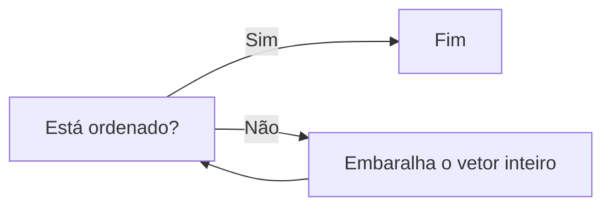

# Bogosort x Slowsort

Trabalho da disciplina de **Estruturas de Dados**, IFRS Campus Canoas.

Este repositório implementa em C dois algoritmos de ordenação famosos por serem **propositalmente ineficientes**, o **Bogosort** e o **Slowsort**. Também mede o tempo de execução dos dois conforme o tamanho do vetor (N) aumenta.

| Integrante | Parte |
| --- | --- |
| [Nome 1] | Bogosort |
| [Nome 2] | Slowsort |
| [Nome 3] | Testes, medição de tempo e gráfico |

Professor(a): [nome]

---

## Sumário

- [Estrutura do repositório](#estrutura-do-repositório)
- [Como compilar e executar](#como-compilar-e-executar)
- [Bogosort](#bogosort)
- [Slowsort](#slowsort)
- [Medição de tempo](#medição-de-tempo)
- [Resultados](#resultados)
- [Comparação](#comparação)
- [Referências](#referências)

---

## Estrutura do repositório

```
.
├── README.md          Este arquivo
├── bogosort.c         Bogosort, estaOrdenado e embaralhar (Fisher–Yates)
├── slowsort.c         Slowsort recursivo
├── main.c             Gera os vetores, repete os testes, mede o tempo e grava os resultados
├── cronometrar.c      Cálculo de tempo fornecido pelo professor
├── resultados.csv     Tempos medidos (N, repetição, algoritmo, tempo)
└── grafico.png        Gráfico do tempo de execução × N
```

## Como compilar e executar

```bash
gcc main.c bogosort.c slowsort.c cronometrar.c -o testes
./testes
```

> [!NOTE]
> Ajuste o comando conforme a organização do `cronometrar.c` (por exemplo, se ele tiver um `.h` próprio ou precisar de alguma biblioteca extra).

---

## Bogosort

### Ideia

O Bogosort ordena **por tentativa e erro**. Ele verifica se o vetor está ordenado; se não estiver, embaralha o vetor inteiro de forma aleatória e verifica de novo, até acertar por sorte.

É como jogar um baralho para cima e recolher as cartas, repetindo até elas caírem em ordem. Também é conhecido como *permutation sort*, *stupid sort* e *monkey sort*, este último por causa do teorema do macaco infinito.



É um algoritmo do tipo **Las Vegas**: usa sorteio, mas, quando termina, a resposta está sempre certa. O que varia é o tempo.

### Implementação

```c
int estaOrdenado(int v[], int n) {
    for (int i = 0; i < n - 1; i++) {
        if (v[i] > v[i + 1]) {
            return 0;
        }
    }
    return 1;
}

void embaralhar(int v[], int n) {
    for (int i = n - 1; i > 0; i--) {
        int j = rand() % (i + 1);
        int temp = v[i];
        v[i] = v[j];
        v[j] = temp;
    }
}

long long bogosort(int v[], int n) {
    long long tentativas = 0;
    while (!estaOrdenado(v, n)) {
        embaralhar(v, n);
        tentativas++;
    }
    return tentativas;
}
```

- **`estaOrdenado`** compara os vizinhos dois a dois (`n - 1` pares) e para no primeiro par fora de ordem.
- **`embaralhar`** usa o algoritmo de **Fisher–Yates**: percorre o vetor do fim para o começo e, para cada posição `i`, sorteia uma posição `j` entre `0` e `i` e troca as duas. Assim, todas as `n!` ordens possíveis têm a mesma chance de sair. Cada embaralhamento faz `n - 1` trocas.
- **`bogosort`** repete os dois até o vetor ficar ordenado e devolve quantos embaralhamentos foram feitos.
- `srand(time(NULL))` é chamado **uma única vez**, no início do `main`. Chamar dentro do laço repetiria os mesmos sorteios durante um segundo inteiro.

### Complexidades

| Caso | Tempo | Explicação |
| --- | --- | --- |
| Melhor | O(n) | O vetor já vem ordenado: uma verificação com `n - 1` comparações e nenhum embaralhamento |
| Médio | O(n · n!) | Existem `n!` ordens e só uma é a certa; em média são `n!` embaralhamentos, cada um custando O(n) |
| Pior | Ilimitado | Cada embaralhamento é um sorteio independente; nada garante que a ordem certa apareça |
| Espaço | O(1) | Ordena no próprio vetor, sem vetor auxiliar e sem recursão |

Pela análise de Gruber, Holzer e Ruepp (2007), com valores distintos:

- número esperado de embaralhamentos: **n!**
- número esperado de trocas: **(n − 1) · n!**
- número esperado de comparações: **≈ (e − 1) · n! ≈ 1,72 · n!**

A verificação quase sempre para cedo (em média cerca de 1,7 comparações por tentativa), então o custo dominante é o embaralhamento.

> [!TIP]
> Com valores repetidos (por exemplo, `rand() % 100`), existe mais de uma ordem correta, e o Bogosort tende a terminar mais rápido que o esperado para valores distintos.

### Variantes

| Variante | Como funciona |
| --- | --- |
| Bogosort determinístico | Testa as permutações em ordem lexicográfica, sem repetir. Sempre termina; pior caso O(n · n!) |
| Bozosort | Em vez de embaralhar tudo, troca apenas dois elementos sorteados por vez. Continua fatorial no caso médio |
| Bogobogosort | Usa o próprio algoritmo, de forma recursiva, para verificar se a lista está ordenada. Ainda mais lento |

### Prós e contras

| Prós | Contras |
| --- | --- |
| Código curto e fácil de entender | Caso médio O(n · n!): inviável a partir de n ≈ 11 |
| Espaço O(1) | Pior caso ilimitado: não há garantia de que termine |
| Melhor caso O(n) | Tempo imprevisível entre execuções |
| Sempre correto quando termina (Las Vegas) | Não aproveita nada das tentativas anteriores |
| Ótimo para ensinar crescimento fatorial e probabilidade | Não é estável e depende da qualidade do gerador aleatório |

---

## Slowsort

### Ideia

O Slowsort foi apresentado por **Andrei Broder e Jorge Stolfi** no artigo *Pessimal Algorithms and Simplexity Analysis* (1984), como paródia do "dividir e conquistar". A estratégia foi batizada de **multiplicar e render-se** (*multiply and surrender*).

Para ordenar o trecho `v[i..j]`:

1. Ordena recursivamente a 1ª metade; o maior dela vai para `v[m]`.
2. Ordena recursivamente a 2ª metade; o maior dela vai para `v[j]`.
3. Compara `v[m]` e `v[j]` e leva o maior de todos para o fim (`v[j]`).
4. Ordena recursivamente **tudo de novo, menos o último elemento**.

O passo 4 é o desperdício: depois de ordenar as duas metades, o algoritmo descarta esse trabalho e reordena quase o vetor inteiro.

### Implementação

```c
void slowsort(int v[], int i, int j) {
    if (i >= j) return;
    int m = (i + j) / 2;
    slowsort(v, i, m);
    slowsort(v, m + 1, j);
    if (v[m] > v[j]) {
        int temp = v[m];
        v[m] = v[j];
        v[j] = temp;
    }
    slowsort(v, i, j - 1);
}
```

Chamada inicial: `slowsort(v, 0, n - 1);`

### Recorrência

$$T(n) = 2\,T\left(\frac{n}{2}\right) + T(n - 1) + 1$$

São duas chamadas nas metades, mais uma chamada para `n - 1` elementos, mais uma comparação. A solução cresce como **n^Θ(log n)**: mais rápido que qualquer polinômio (n², n³…), mas mais devagar que uma exponencial.

Contagem exata de comparações pela recorrência:

| n | Comparações |
| ---: | ---: |
| 10 | 82 |
| 100 | ≈ 1,8 milhão |
| 200 | ≈ 114 milhões |
| 500 | ≈ 65,7 bilhões |

### Complexidades

| Caso | Tempo | Explicação |
| --- | --- | --- |
| Melhor | n^Θ(log n) | As comparações não dependem da ordem dos dados: um vetor já ordenado custa o mesmo |
| Médio | n^Θ(log n) | Idem; só a quantidade de trocas muda |
| Pior | n^Θ(log n) | Idem; o algoritmo é determinístico e sempre termina |
| Espaço | O(n) | Não usa vetor auxiliar, mas a pilha de recursão chega a profundidade ≈ n por causa de `slowsort(v, i, j - 1)` |

### Prós e contras

| Prós | Contras |
| --- | --- |
| Sempre termina, com tempo previsível | Superpolinomial em todos os casos, até no melhor |
| Não usa vetor auxiliar | Não ganha nada com vetor já ordenado |
| Mostra como uma recursão "inocente" pode explodir o custo | Pilha de recursão O(n): risco de estouro com n grande |
| Bom para treinar análise de recorrências | Muito mais lento que um simples Bubble Sort, que é O(n²) |

---

## Medição de tempo

O tempo é medido com as funções do **`cronometrar.c`**, fornecido pelo professor, cronometrando **apenas a chamada do algoritmo** (a geração do vetor fica fora da medição).

Metodologia:

- **Entrada:** vetores com valores aleatórios (`rand() % 100`), gerados de novo a cada repetição.
- **Semente:** `srand(time(NULL))` uma única vez, no início do `main`.
- **Repetições:** [10] execuções para cada tamanho N; é registrada a **média** dos tempos.
- **Tamanhos testados:**
  - Bogosort: N = 2 a [10]. Em N = 11, uma única execução já leva cerca de 10 s.
  - Slowsort: N = 10 a [200], de 10 em 10. Em N = 250, uma execução já leva alguns segundos.
  - Os dois também são comparados nos mesmos N pequenos (2 a 10).
- **Vetores por algoritmo:** a cada repetição, o mesmo vetor aleatório é copiado para os dois algoritmos, para que comparem exatamente a mesma entrada.

Estrutura do laço de testes no `main.c`:

```c
srand(time(NULL));
for (int n = 2; n <= N_MAX; n++) {
    int *v = malloc(n * sizeof(int));
    for (int r = 0; r < REPETICOES; r++) {
        for (int i = 0; i < n; i++) {
            v[i] = rand() % 100;
        }
        /* iniciar o cronômetro (cronometrar.c) */
        bogosort(v, n);
        /* parar o cronômetro e gravar o tempo em resultados.csv */
    }
    free(v);
}
```

> [!NOTE]
> As faixas de N são diferentes porque o Bogosort fica inviável muito antes do Slowsort. Os tempos citados acima vêm de testes preliminares; os valores finais estão em `resultados.csv`.

---

## Resultados


O gráfico usa **escala logarítmica** no eixo do tempo; sem ela, a curva do Bogosort vira uma parede e o resto some.

| N | Bogosort: média (s) | Slowsort: média (s) |
| ---: | ---: | ---: |
| 4 | [__] | [__] |
| 6 | [__] | [__] |
| 8 | [__] | [__] |
| 10 | [__] | [__] |
| 50 | não testado | [__] |
| 100 | não testado | [__] |
| 200 | não testado | [__] |

[Escrever aqui 2 ou 3 frases sobre o que os dados mostram.]

---

## Comparação

| Critério | Bogosort | Slowsort |
| --- | --- | --- |
| Estratégia | Aleatória: embaralha e testa | Recursiva: multiplicar e render-se |
| Determinístico? | Não | Sim |
| Melhor caso | O(n) | n^Θ(log n) |
| Caso médio | O(n · n!) | n^Θ(log n) |
| Pior caso | Ilimitado | n^Θ(log n) |
| Espaço | O(1) | O(n) (pilha) |
| Sempre termina? | Não é garantido | Sim |
| N viável nos testes | até ≈ 10 | até ≈ 200 |

**Conclusões:**

1. O fatorial cresce muito mais rápido que n^log n: conforme N aumenta, o Bogosort fica muito pior que o Slowsort.
2. Complexidade não é só o pior caso: o Bogosort tem melhor caso O(n), enquanto o Slowsort nunca melhora.
3. Os dois servem de contraste para algoritmos como o **Merge Sort**, que é O(n log n) em todos os casos. O que define a eficiência é o algoritmo, não a velocidade do computador.

---

## Referências

BLACK, P. E. Bogosort. In: BLACK, P. E. (ed.). **Dictionary of Algorithms and Data Structures**. Gaithersburg: National Institute of Standards and Technology, 2023. Disponível em: https://www.nist.gov/dads/HTML/bogosort.html. Acesso em: 23 nov. 2026.

BRODER, A.; STOLFI, J. Pessimal algorithms and simplexity analysis. **ACM SIGACT News**, v. 16, n. 3, p. 49-53, 1984.

CORMEN, T. H. et al. **Algoritmos**: teoria e prática. Tradução da 3. ed. americana. Rio de Janeiro: Elsevier, 2012.

DURSTENFELD, R. Algorithm 235: random permutation. **Communications of the ACM**, v. 7, n. 7, p. 420, 1964.

GRUBER, H.; HOLZER, M.; RUEPP, O. Sorting the slow way: an analysis of perversely awful randomized sorting algorithms. In: CRESCENZI, P.; PRENCIPE, G.; PUCCI, G. (ed.). **Fun with Algorithms**: 4th International Conference, FUN 2007. Berlin: Springer, 2007. p. 183-197. (Lecture Notes in Computer Science, v. 4475). DOI: 10.1007/978-3-540-72914-3_17.

KNUTH, D. E. **The art of computer programming**: volume 2: seminumerical algorithms. 3. ed. Reading: Addison-Wesley, 1997.

MOTWANI, R.; RAGHAVAN, P. **Randomized algorithms**. Cambridge: Cambridge University Press, 1995.

RAYMOND, E. S. (ed.). **The new hacker's dictionary**. 3. ed. Cambridge: MIT Press, 1996.

ZIVIANI, N. **Projeto de algoritmos**: com implementações em Pascal e C. 3. ed. rev. e ampl. São Paulo: Cengage Learning, 2011.
